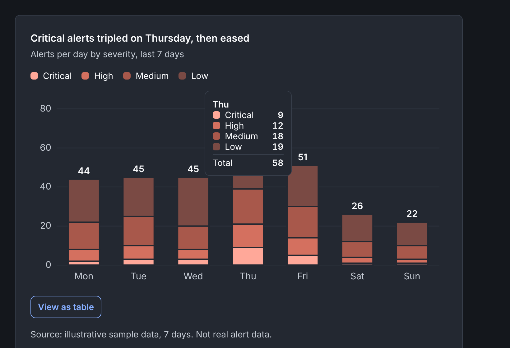

# Design token pipeline: Figma variables to Storybook

A small, working example of how a design decision travels from Figma to code without being retyped.

One Button component and one data visualization pattern, both driven by the same tokens, both checked automatically for accessibility and contrast.



## What is in here

| Piece | What it shows |
|---|---|
| Figma file (variables, Button component set, Light and Dark specimens) | Tokens in three tiers: primitives, semantic, component. Variable names carry a WEB code syntax that becomes the CSS variable name. |
| `tokens/figma-variables.json` | The export from Figma. Source of truth. |
| `scripts/build-tokens.mjs` | Builds `src/tokens/tokens.css` (Light, Dark, and a `prefers-color-scheme` fallback). Fails on a bad alias. |
| `scripts/check-tokens.mjs` | Governance check. WCAG contrast pairs per mode, focus ring against every fill, severity ramp stays in order. Blocks the build if anything fails. |
| `src/components/Button` | React and TypeScript. Token-only CSS. Intent x Size x State, matching the Figma variants. |
| `src/components/SeverityTrendChart` | Stacked bar chart with a legend, a table alternative, loading, empty, and error states. |
| `scripts/a11y-stories.mjs` | Runs axe (WCAG 2.2 AA rules) on every story in both themes. |
| `.github/workflows/ci.yml` | Runs all of the above on every push. |

## Run it

```bash
npm install
npm run storybook          # builds tokens, runs the contrast check, starts Storybook
npm run build-storybook
npm run test:a11y          # needs a Chromium; set CHROMIUM_PATH if Playwright cannot find one
```

## Decisions worth explaining

**Why three token tiers.** A rebrand changes primitives. A new theme changes semantic aliases. Components never change. That is what makes a framework migration or a second platform cheap.

**Why the governance check exists.** The first run caught a real failure: the Light focus ring against the primary button fill was 2.82:1, under the 3:1 minimum for non text contrast. I fixed it in Figma (primary now uses blue 500, hover blue 600), re-exported, and the check passes. Catching that at build time is cheaper than catching it in an audit.

**Why severity is one hue, not a rainbow.** Severity is ordered, so it reads as light to dark in a single hue. I first tried a categorical red and amber palette and it failed the colorblind separation and lightness checks, so I changed approach rather than tweaking numbers.

**Why the chart has a table.** Color alone should never carry meaning. Every chart has a legend, labeled totals, a table view, and a stated source.

## Honest notes

- **How this was built.** I used Claude to scaffold the code and the Figma file. I made the design decisions, reviewed the output, and verified the results: token checks, TypeScript, Storybook build, and axe in both themes. I can walk through any file in this repo.
- **The build script is small and custom.** At production scale I would use Style Dictionary or Tokens Studio. The contract (JSON in, CSS variables out) stays the same.
- **Known drift between Figma and code.** In Figma, the secondary button Focus variant replaces its 1px inner border with the outside ring. In code the inner border stays. Small, documented, and the kind of thing a sync process should surface.
- **Sample data is illustrative.** Nothing here comes from a real product or employer.
- **Not covered yet.** Automated Figma sync, visual regression tests, and screen reader testing with real assistive tech. Axe catches roughly a third to half of issues, so it does not replace manual testing.

## Put it on GitHub

```bash
cd design-token-pipeline
git init && git add . && git commit -m "Design token pipeline: Figma variables to Storybook"
gh repo create design-token-pipeline --public --source=. --push
```
